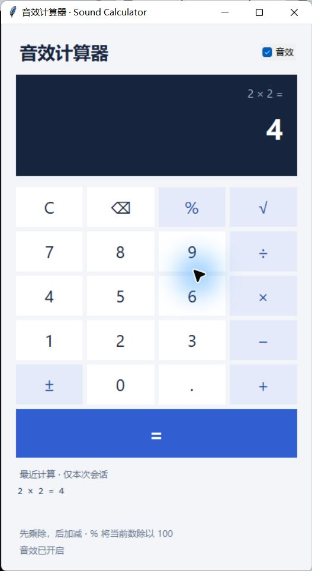

# Sound Calculator · 音效计算器

一个用 Python / Tkinter 编写的小型桌面计算器：支持四则运算、百分号、平方根、键盘输入、会话历史和可关闭的按键音效。

[](https://github.com/Eating-King-Git/sound-calculator/actions/workflows/tests.yml)

<p align="center"></p>

[使用与运算规则](#运算规则) · [验证记录](docs/validation.md) · [设计说明](docs/design.md) · [来源与许可](THIRD_PARTY_NOTICES.md)

**English:** A small Tkinter desktop calculator with decimal arithmetic, operator precedence, optional button sounds and session history. No `eval`, network service, account or database is required. The interface is in Chinese.

## 快速开始

建议使用带 Tkinter 的 Python 3.10 或更新版本。Windows 官方 Python 安装中的 Tcl/Tk 组件需保留；精确验证环境见[验证记录](docs/validation.md)。

PowerShell：

```powershell
git clone https://github.com/Eating-King-Git/sound-calculator.git
cd sound-calculator
python -m venv .venv
.\.venv\Scripts\python.exe -m pip install -r requirements.txt
.\.venv\Scripts\python.exe calculator.py
```

无需激活虚拟环境。`requirements.txt` 只有 Pygame，负责可选音效；基本计算与界面使用 Python 标准库。

**只想静音使用：**可以不安装 Pygame，直接运行 `python calculator.py --mute`。缺少 Pygame、音效文件或音频设备时也会自动静音，界面底部会显示状态。

Linux 使用 `.venv/bin/python`；Tkinter 可能需要通过发行版的软件包管理器安装。macOS 的窗口与音频行为尚未验证。首版提供源码，不提供打包 EXE。

## 运算规则

| 操作 | 行为与例子 |
|---|---|
| 四则运算 | 先乘除后加减：`2 + 3 × 4 = 14` |
| 连续运算符 | 后输入的运算符替换前一个；输入负数请用 `±` |
| 正负号 `±` | 切换当前操作数的符号 |
| `%` | 当前操作数除以 100；`200 + 10 % = 200.1`，不是商用计算器的加价百分比模式 |
| 平方根 `√` | 对当前操作数开平方；负数显示错误，不产生复数 |
| 结果后输入数字 | 开始新的算式 |
| 结果后输入运算符 | 使用当前结果接着算 |
| 重复 `=` | 保持结果，不重复上一次运算 |
| `⌫` | 编辑中的数字删除一位；结果上退格开始新算式，一元变换后归零当前数，刚输入运算符时不操作 |
| `C` | 清除当前算式与错误；保留本次会话历史 |
| 出错后输入数字 | 开始新的算式，恢复使用 |

Decimal 运算使用局部 28 位有效数字精度；这不是无限精度计算器。输入限制为 24 位数字，长结果用最多 16 位有效数字的科学计数法缩短显示，内部继续计算时保留 Decimal 的原始精度。非零中间及最终结果的绝对值范围限制为 `1e-99` 至 `1e99`；输入过长、除零、非法平方根或结果越界会显示错误。

不支持括号、三角函数、任意表达式粘贴或科学记数法键盘输入。历史最多保存最近 10 条成功结果，仅存于内存，关闭窗口后清空；长结果的历史文字也是显示值，超长算式在窄窗口中可能显示不全。

## 键盘与音效

| 键盘 | 功能 |
|---|---|
| `0–9`、`.`、`+ - * /` | 数字、小数点和运算 |
| Enter 或 `=` | 计算 |
| Backspace | 退格 |
| Esc、Delete、C | 清除当前算式 |
| F9 | 正负号 |
| R | 平方根 |
| `%` | 当前数除以 100 |

顶部“音效”开关可随时切换。音效采用代码合成的短正弦提示音，素材路径相对于程序文件，因此从其他工作目录启动也能找到。状态为“音效不可用，已静音”时，可检查设备后关闭再打开开关以重试。

## 测试与重生成音效

```powershell
.\.venv\Scripts\python.exe -m unittest discover -v
.\.venv\Scripts\python.exe -m pip check
.\.venv\Scripts\python.exe tools/create_sounds.py
```

计算与音频故障处理测试不依赖真实音箱。Tkinter 集成测试需要显示服务；无显示环境默认明确跳过，CI 设置 `REQUIRE_GUI=1` 将缺失显示视为失败，Ubuntu 使用 Xvfb。云端状态见页面上方徽标。

音效生成只用 `math`、`wave`、`struct` 等标准库，不需要 NumPy 或 SciPy。生成后可以比较 `assets/sounds/` 中的文件，CI 也检查它们是否可重复生成。

## 项目结构

```text
calculator.py             Tkinter 窗口、按钮和键盘映射
calculator_core.py        独立计算模型、输入状态和会话历史
audio.py                  可选音效与静音降级
tools/create_sounds.py     可复现的 WAV 生成器
assets/sounds/            两份短提示音
test_*.py                 计算、音效和 Tk 界面测试
docs/                     设计、验证和真实界面截图
```

## 从旧练习到独立作品

项目从个人计算器练习整理而来，使用 AI 辅助开发与复核。原练习在输入运算符后的下一次数字输入会覆盖前面的表达式；本版以独立状态模型修复，并为 `1+2=3` 等路径加入回归测试。同时移除 `eval`，分离界面与计算、修复资源路径和音频失败行为，补充说明与自动检查。

本仓库只包含桌面计算器，不附带旧目录中的 Flask 网站、环境配置、私人文件或第三方图片。新界面截图来自本项目窗口，WAV 由仓库内脚本生成。

代码与文档采用 [MIT License](LICENSE)。Pygame、Python/Tk 等运行依赖保留各自许可，见 [THIRD_PARTY_NOTICES.md](THIRD_PARTY_NOTICES.md)。
